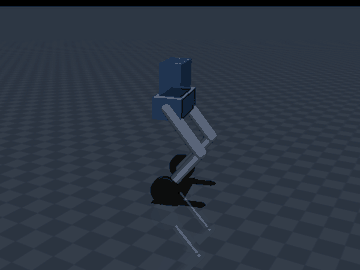
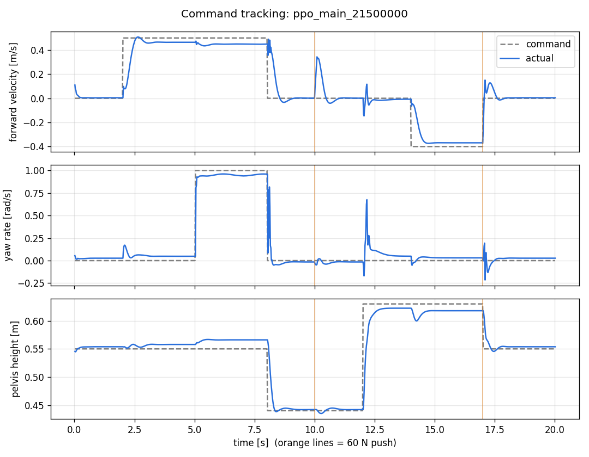
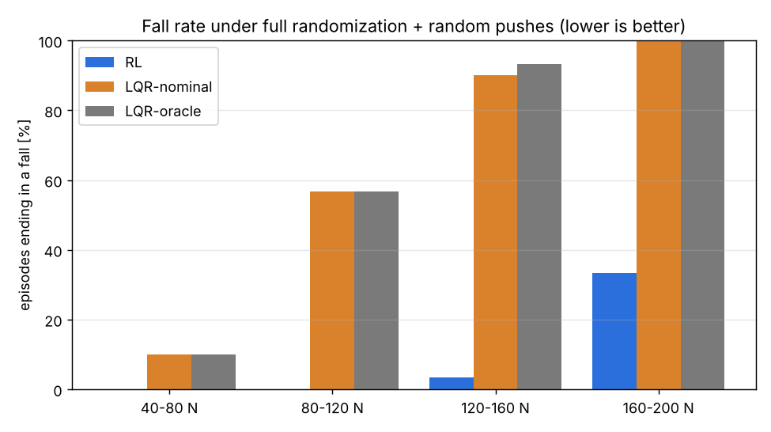
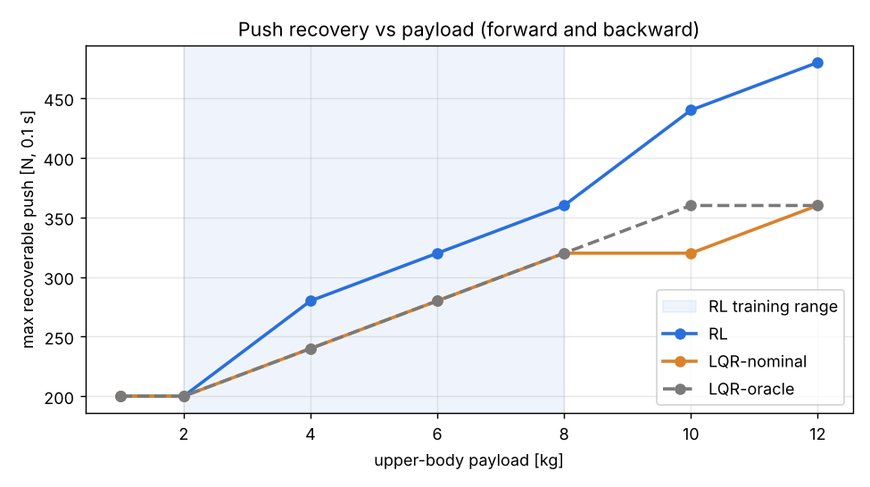
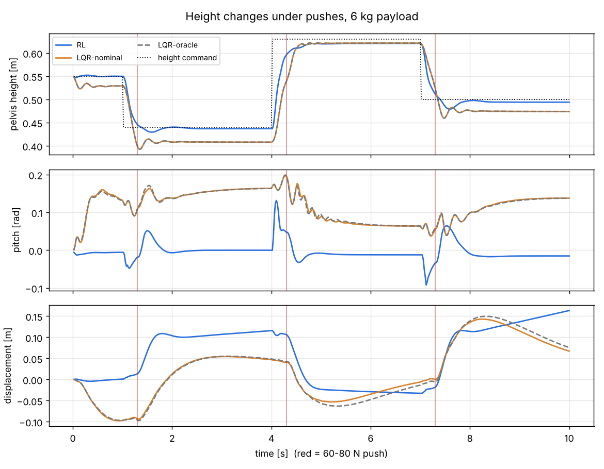

# Wheel-Legged Lower Body — Deep RL Balance & Locomotion

Deep reinforcement learning controller for a wheel-legged humanoid lower body
(hips and below) in MuJoCo, benchmarked against a classical LQR balance controller.

**Result:** a PPO policy (30M steps, ~10 h on a desktop CPU) balances, drives, turns and changes height
while recovering from pushes, under heavy domain randomization. Against LQR baselines with the same motors:
**0% vs 57% falls** under random 80-120 N pushes from any direction, and up to **33% larger** single
pushes recovered (12-17% within the 2-8 kg training range, tied at 1-2 kg).



*Scripted 20 s demo: stand, drive 0.5 m/s, turn 1 rad/s, crouch to 0.44 m, 60 N push, stand tall to
0.63 m, reverse, second 60 N push.*



## Robot
| Part | Detail |
|---|---|
| Pelvis | 6 kg box + 4 kg "upper body" payload (randomized in training) |
| Each leg | hip pitch, knee pitch (PD position servos), driven wheel, r = 0.08 m |
| Actuators | 6 (4 leg servos + 2 wheel motors) |
| Total mass | 16 kg, nominal pelvis height 0.61 m |

Leg kinematics: hip = q, knee = −2q keeps the wheel directly under the hip, so a single
crouch parameter q sets body height (0.2 → tall, 1.0 → deep crouch).

## Layout
```
models/wheel_leg.xml      MuJoCo model
wheel_leg/baselines.py    LQR balance baseline (wheeled-inverted-pendulum model,
                          parameters extracted from the MuJoCo model)
wheel_leg/env.py          Gymnasium environment (obs, action, reward, domain randomization, pushes)
scripts/sanity_check.py   physics checks to run before any RL
scripts/train.py          PPO training (Stable-Baselines3), curriculum, checkpoints, TensorBoard
scripts/play.py           drive the trained policy with the keyboard in the MuJoCo viewer
scripts/record.py         scripted demo -> MP4/GIF + command-tracking plot
scripts/evaluate.py       checkpoint selection + RL vs LQR evaluation (tables + plots)
results/                  plots
```

## Run
```bash
pip install -r requirements.txt
python scripts/sanity_check.py           # headless, writes results/sanity_check.png
python scripts/sanity_check.py --view 5  # watch a test in the MuJoCo viewer
```

## RL formulation
| | |
|---|---|
| Observation (25) | projected gravity, gyro, leg joint pos/vel, wheel speeds, command (vx, yaw rate, height), previous action |
| Action (6) | 4 leg joint position targets (PD servos) + 2 wheel velocity targets (500 Hz motor velocity loop) |
| Reward | velocity / yaw-rate / height tracking + upright, minus roll, angular-rate, action-rate, torque and leg-asymmetry penalties; -10 on fall |
| Algorithm | PPO, 8 parallel envs, 2x256 ELU MLP, observation/reward normalization, 50 Hz policy |
| Domain randomization | payload 2-8 kg and CoM height, friction 0.5-1.2, wheel motor strength +-20%, servo stiffness +-30%, damping, 0-10 ms latency, sensor noise |
| Realism | DC-motor torque-speed curve on the wheels (0 torque at 30 rad/s) |
| Curriculum | command ranges and push strength ramp from 20% to 100% over the first 10M steps |

## Train
```bash
python scripts/train.py                          # full run (30M steps)
tensorboard --logdir runs                        # curves: rollout/ep_len_mean, metrics/*
python scripts/play.py --run ppo_main            # drive it: arrows, PgUp/PgDn, P = push
python scripts/record.py --run ppo_main --gif    # demo video + tracking plot
python scripts/play.py --lqr                     # classical baseline for comparison
python scripts/evaluate.py --select              # rank checkpoints
python scripts/evaluate.py --ckpt 21500000       # RL vs LQR evaluation
```

## Results (final model: checkpoint 21.5M steps)
Checkpoints from 10M-30M were ranked by fall rate and tracking error under full randomization;
the last checkpoints were slightly worse (policy over-updating after convergence), so 21.5M is used.

Baselines (same wheel motors, torque limit and torque-speed curve):
- **LQR-nominal**: wheeled-inverted-pendulum LQR designed once for the nominal robot, 500 Hz, *perfect state*
- **LQR-oracle**: same, re-designed for the *true* payload and gain-scheduled with leg height every 50 ms

The RL policy runs at 50 Hz on noisy IMU/encoder readings. LQR legs follow a rate-limited crouch trajectory.

**Command tracking** (RL, 50 x 20 s episodes, full randomization + random pushes): 0% falls,
mean error 0.065 m/s forward speed, 0.074 rad/s yaw rate, 0.9 cm height.

**Fall rate, full randomization + random pushes from any direction every 2-3 s** (30 x 20 s per band)

| push strength | RL | LQR-nominal | LQR-oracle |
|---|---|---|---|
| 40-80 N | **0%** | 10% | 10% |
| 80-120 N | **0%** | 57% | 57% |
| 120-160 N | **3%** | 90% | 93% |
| 160-200 N | **33%** | 100% | 100% |



**Max recoverable single push (0.1 s, forward and backward)**

| payload [kg] | 1* | 2 | 4 | 6 | 8 | 10* | 12* |
|---|---|---|---|---|---|---|---|
| RL [N] | 200 | 200 | **280** | **320** | **360** | **440** | **480** |
| LQR-nominal [N] | 200 | 200 | 240 | 280 | 320 | 320 | 360 |
| LQR-oracle [N] | 200 | 200 | 240 | 280 | 320 | 360 | 360 |

\* outside the 2-8 kg training range



**Height changes under pushes** (6 kg payload): all controllers survive; RL keeps the pelvis level
(|pitch| < 0.13 rad, near 0 at rest) by moving the wheels under the CoM, while LQR leans the body
0.1-0.2 rad; RL tracks height within ~0.5 cm vs ~3 cm leg sag for the open-loop crouch of the baselines.



### What the comparison does and does not show
- For **forward/backward pushes only**, LQR is about as good as RL up to ~160 N, even with randomized
  dynamics (0-10% falls for both). The large gap above comes from **pushes from other directions**:
  lateral/diagonal shoves excite yaw and roll, which the planar WIP model ignores. The RL policy learned
  3D disturbance rejection using legs and differential wheel torque.
- A stronger classical design (yaw/roll control, whole-body MPC) would narrow the gap; the point here is
  that one learned policy gets this robustness without a hand-built model of the coupled dynamics.
- Checkpoint 21.5M was chosen partly on push robustness measured with these tests (mild selection bias).


## Stage 1 results
| Check | Result |
|---|---|
| Passive (no wheel torque) | falls in 0.58 s, as an inverted pendulum should |
| LQR from 0.1 rad tilt | recovers, holds position within 3 cm |
| 40 N push, 0.1 s | recovers, max displacement 0.16 m |
| Height change 0.37–0.67 m (gains designed at nominal height) | stays balanced, pitch excursion up to 0.22 rad |

## Roadmap
- [x] MuJoCo model, physics validation, LQR baseline
- [x] Gymnasium environment (observation, action, reward)
- [x] PPO training pipeline with curriculum + domain randomization
- [x] Full training run: balance + velocity + height commands + push recovery
- [x] RL vs LQR evaluation (push recovery, payload variation, height tracking)
- [ ] Yaw drift / steady-state offset fixes (heading-hold term, integral-style observation)
- [ ] ROS 2 node wrapping the policy (/imu, /joint_states -> /cmd)
- [ ] Rough terrain / steps using the legs as active suspension
